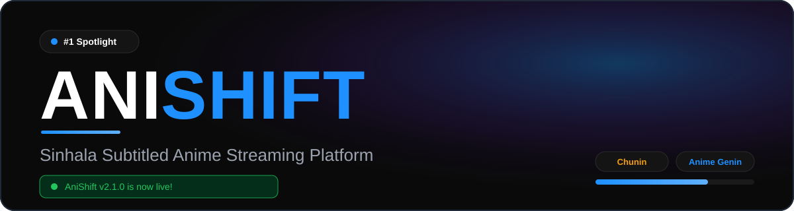

 

---

## 🎌 About AniShift

**AniShift** is a Sinhala-subtitled anime platform built for the Sri Lankan community. Browse trending series, track what you watch, earn XP and climb the leaderboard.

> 💬 *Community-made Sinhala subtitles. AniShift does not host any video files.*

---

## ✨ Features

<table>
  <tr>
    <td width="33%" valign="top">

### 🔥 Spotlight
Featured anime carousel with ratings, episode counts and quick **Details** / **Add to List** actions.

  </td>
    <td width="33%" valign="top">

### 🧭 Discover
Browse by genre (Isekai, Mecha, Romance, Psychological and more) and use the search and filter tools.

  </td>
    <td width="33%" valign="top">

### 🕘 Watch History
Pick up right where you left off, with the exact timestamp for every episode.

  </td>
  </tr>
  <tr>
    <td valign="top">

### 🏆 XP & Rank System
Earn XP, level up and rise through ranks like *Anime Genin* and *Chunin Specialist* on the **Top 10 leaderboard**.

  </td>
    <td valign="top">

### 📊 Profile Statistics
Personal profile with your stats, watch list and progress.

  </td>
    <td valign="top">

### ⬇️ Episode Downloads
Download episodes (new in **v2.1.0**), plus notifications for new updates.

  </td>
  </tr>
</table>

---

## 📦 Projects

<table>
  <tr>
    <td>
      
    </td>
    <td>
      
    </td>
  </tr>
  <tr>
    <td>
      
    </td>
    <td></td>
  </tr>
</table>

---

## 🛠️ Tech Stack

<!-- ඔයා ඇත්තටම පාවිච්චි කරන ඒවා විතරක් තියාගන්න. වෙනත් badge: https://shields.io -->

---

## 📈 GitHub Stats

---

## 📫 Get in touch

- 🌐 Website: [anishift.netlify.app](https://anishift.netlify.app/home)
- 📧 Email: [anishift.anm@gmail.com](mailto:anishift.anm@gmail.com)
- 📍 Sri Lanka 🇱🇰

**Made with ❤️ for the anime community**

